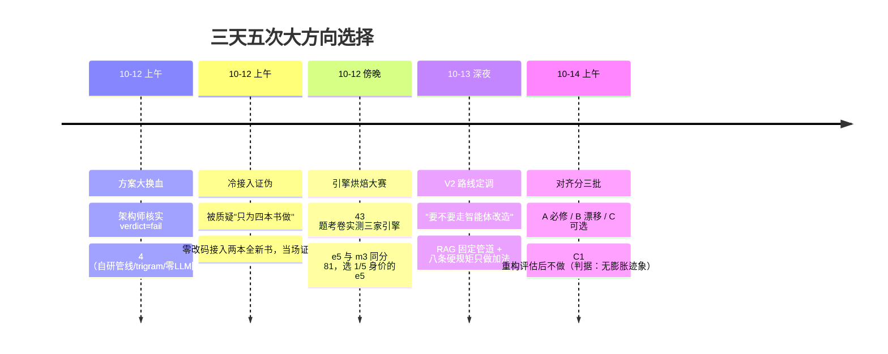
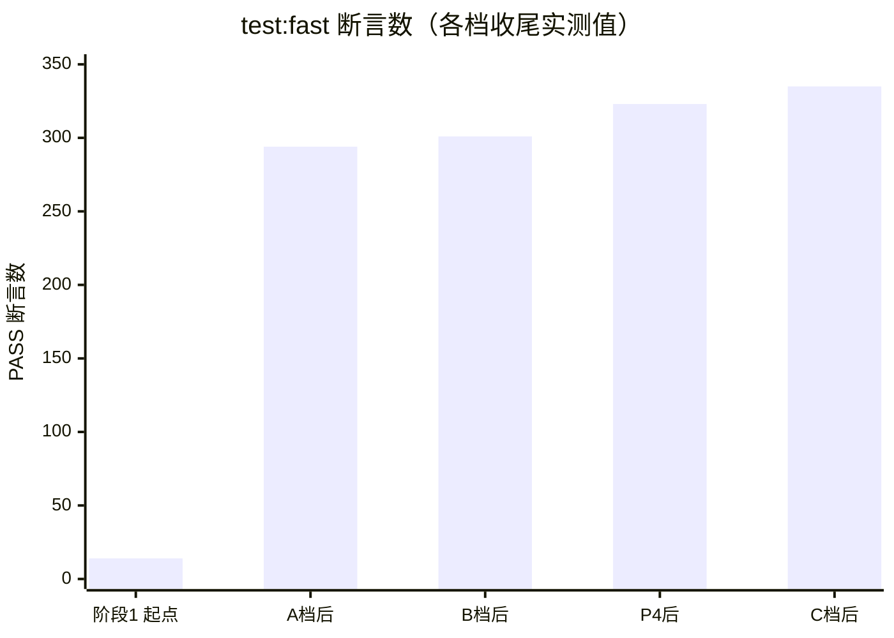
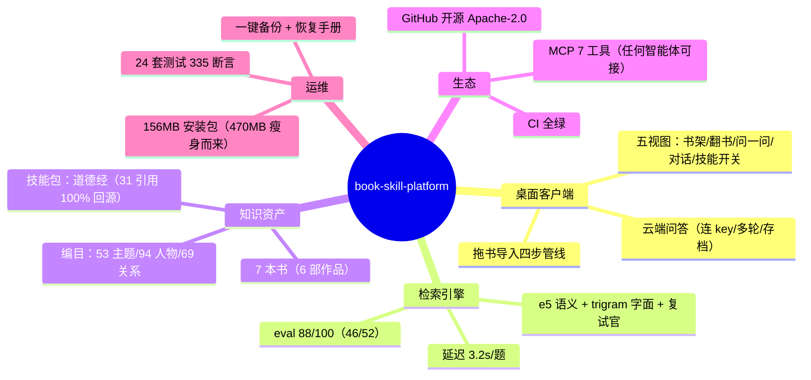

# 项目全程复盘分析（决策者视角）

> 类型：全量复盘 · 只按代码、提交与工作日志的实际说话
> 日期：2026-10-14
> 范围：2026-10-12 早晨（一张方案纸）→ 2026-10-14 上午（开源 + 云端问答 + 界面对齐），52 个 commit 全覆盖
> 视角：每个岔路口——选了什么、当时为什么、结果对不对

---

## 〇、一页结论

**三天，从一张方案纸到开源可用的产品，52 个 commit，核心质量门（eval-gate）从未被击穿。**

成功不是"写得快"，是三根支柱：

| 支柱 | 一句话 | 证据 |
|---|---|---|
| **实验否决制** | 一切选型用考卷说话，同分选便宜的；数据推翻假设就认账 | 引擎烘焙大赛（43 题考卷）、q4 复试官实测否决、vec-cache 默认关 |
| **防线前置** | 每修一个坑，就地长一条机器断言，同一个坑不许咬第二次 | 测试从阶段1 的 14 断言长到 335；guard 静态防线 34 项 |
| **只做加法** | 老代码能不动就不动，新功能寄生在老体系上长 | V2 八条硬规矩；UI 对齐 A/B/C 分批；每步独立提交可回滚 |

三个最险的瞬间（都救回来了，靠什么见第四节）：**方案 v1.1 四颗雷**（差一点全盘返工）、**道德经技能包"81 章速查"谎报**（防幻觉体系差一道闸门）、**CI 假绿**（模拟克隆读到真实项目路径，差点把假绿当真绿发布）。

---

## 一、方向层：五次大选择

**逐条复盘：**

1. **方案大换血（最重要的一次）**。v1.1 方案基于 mcp-local-rag + FTS5 默认分词 + GraphRAG + fastmcp。老板一句"这方案有雷吗"触发架构师联网核实——verdict: fail，四项全有硬雷。当时选择全部替换而不是"先跑跑看"。**事后看：若开工后再发现 epub 不支持/中文分词不可用/混栈打包灾难，等于全部返工。这是整个项目回报率最高的一次决策。**

2. **冷接入证伪**。被质疑"是否只为这四本书做的"时，没有辩解，直接抓两本全新书（《道德经》《Frankenstein》）零改码走完整管线。这个动作同时回答了"架构是否通用"和"下一步该做什么"（把接书做成一键拖入）。

3. **引擎烘焙大赛**。不做"我觉得哪个好"，做 43 题金标准考卷（简体问繁体原文=纯语义考）。三家引擎×有无复试官六个组合同场竞技。e5 与 m3 打平（81 分），m3 要 542MB、e5 只要 112MB——**同分选便宜的，省下的 430MB 直接进了安装包体积**。

4. **V2 路线定调**。老板深夜提出"加一个能聊天的智能体"。盘账后发现：看目录/看原文/引用跳转全是现成的，真正缺的只有"生成层"。选择固定管道 RAG（本地检索当眼睛、云端当笔、引用校验当良心），拒绝全自主智能体改造——"智能体是壳，可信是芯"。配套八条硬规矩把"只做加法"写死。

5. **对齐分三批 + C1 不做**。A 档（用户会撞上的硬伤）先修，B 档（一致性漂移）一批收口，C 档（可选项）逐个评估。C1 事件总线重构评估后**决定不做**——判据是"监听器继续膨胀才做"，实测无膨胀；重构动四个视图违背加法原则。**会说不做和会做一样重要。**

---

## 二、技术层：每个关键数凭什么

| 关键数/选型 | 当时的依据 | 事后验证 |
|---|---|---|
| 引擎 = multilingual-e5-small | 烘焙大赛：裸 63 / +复试官 81，与 m3 同分 | 1/5 体积，384 维全库覆盖，eval 88 一直用到今天 |
| 复试官 = bge-reranker-v2-m3 int8 | 逐对 120ms/对；q4 实测慢 67 倍且分数变形、批量前向分数不可靠 | 换将后 eval 86→88，两案翻案（convs2s/gardiner 直上 top-1） |
| 主题点火 margin ≥ 0.05 | 0.03 时 pemberley 英文题被打翻（84 分回归） | 两次翻车验证后写进红线，此后未再破防 |
| 弱信号 < 0.15 不扰动 | 高频人物弱信号把骰子（乱数）扰动进结果 | "打翻过 pemberley 两次"成为 MEMORY 铁律 |
| 引用校验 = 60% 子句命中 | 与 skill-store 同款算法独立实现 | 首跑 DeepSeek 就拦下一次 QUOTE_FAIL——防线在工作，不是摆设 |
| topN 统一 = 6 | 两页喂云端、给用户看的必须同样段数 | "基于以上 N 段原文写作"从声称变成事实（B1） |
| 字面腿 = 关键词提名制 top-12 | 整句短语 MATCH 命中 0；无封顶版 86→81（"可以"df=7 纯噪声） | 弯路实测后用封顶+df 过滤救回，convS2S 答案块从池外进 top-20 |

**技术层的元规则**：每个数都有出处——要么是考卷分数，要么是翻车记录，要么是对照实验。没有一个是"经验值"。

---

## 三、工程层：测试怎么长成防线

**防线的四层结构**（从内到外）：

1. **单元防线**：24 套测试（fast 12 + slow 8 + 专项 4），覆盖解析/切片/检索/编目/技能/MCP/IPC/渲染图/LLM 全链路。
2. **eval-gate 双门**：分数 ≥ 基线（88）**且**漏题清单 ⊆ 基线漏题——改检索代码必跑，改漏题清单必须写进 commit message。防"总分没掉但悄悄漏了一道题"。
3. **guard 静态断言**：34 项，专防"人不在场"的回归——渲染层禁直连 fetch、每处 spawn 必带 nodeEnv()、配置卡单一实现、topN 不许字面量漂移。**经验：静态断言必须剔注释行（注释里提到禁词会假红）。**
4. **打包三层验收**：asar 对账 + 过滤后树真跑 embedding/解析 + 打包 exe 自检——沙箱起不了 Electron 渲染进程，就用通道层测试（同一份注册代码）+ 真机勾选单补位。

**一个造假根的治理**：阶段0 旧测试是"复制代码自测自"（永远绿的假测试），重写为直接调真实实现。这件事确立了一条规矩：**测试不许测复制品。**

---

## 四、教训层：差点翻车的八个瞬间

| # | 险情 | 差在哪 | 靠什么救回 |
|---|---|---|---|
| 1 | 方案 v1.1 四颗雷 | 若直接开工=全盘返工 | 老板质疑 + 架构师联网核实，v1.2 全换 |
| 2 | 旧库无 meta.model，静默跳过重灌 | 引擎换了但库里还是旧向量，检索结果错但没人知道 | 改为"标签对不上必重灌"+ assertEngine 卫兵两端挂 |
| 3 | 道德经包声称"81 章速查"实际覆盖 14 章 | 智能体当导航依据的谎报，用户会被骗 | coverage-check 三道质检；铁律：**声称必须机器可验** |
| 4 | 子 Agent 通道报废（37 分钟零回报） | 派出去的活全蒸发在残影文件系统里 | 探针实证后立即收回主对话，铁律入 MEMORY |
| 5 | CI 假绿（junction 模拟读到真实项目） | 模拟克隆"全绿"，云端必红——差点把假绿当真绿 | 拆独立 step 定位 + 铁律：模拟前先 grep 硬编码路径 |
| 6 | G-01 打包态拖书卡死 | dev 态正常掩盖打包态 spawn 缺环境变量 | 对照组实验（env -u ELECTRON_RUN_AS_NODE）实锤复现 |
| 7 | 沙箱三限制（渲染进程崩/rm 拦截/隧道 502） | 大量时间耗在"环境不是产品问题"的排查上 | 每次实锤都写进 MEMORY（mv 代替 rm、裸跑 dist、重试推送） |
| 8 | pemberley 两次被打翻 | 检索调参的"好心"信号反而制造噪声 | margin/地板阈值双红线，弱信号一律不扰动 |

**教训层的元规则**：每个坑修完都有三件套——修掉的代码 + 防回归断言 + 写进 MEMORY/docs 的记录。坑只许咬一次。

---

## 五、成果层：今天的家底

**数字总账**：52 commit / 3 天 · 35 个源码文件 · 17 份文档 · 24 套测试 335 断言 · 修缺陷 30+（暴力测试 10 + G 系列 4 + D 系列 12 + 其他）· 登记不修 9 项（全部有理由记录在案）· 5 道漏题定性为"语义陷阱块"（块里没有答案语义，任何裁判救不了——是边界不是缺陷）。

**还欠的账**（如实）：真机 GUI 验收等老板 30 分钟；正式 exe 待重打（V2 + 对齐全部要进包）；P&P/Frankenstein 两个老库待重建（切分改进前建的，4 块超 3000 字）。

---

## 六、可复用方法论（下次直接照抄）

1. **先方案后动手，方案先过"找雷关"**——质疑自己的方案比写方案更值钱。
2. **试金石前置**——最可能死的三件事（中文检索/四格式解析/exe 打包）放在第一天上午试。
3. **选型用考卷，同分选便宜的**——不辩论，跑分。
4. **实测否决制**——数据推翻假设就认账（vec-cache 白做了就默认关）。
5. **声称必须机器可验**——覆盖范围/章节数/索引指向，一律过自检，不靠生成方自觉。
6. **每修一坑就地长一条断言**——坑只许咬一次。
7. **eval-gate 双门**——分数门 + 漏题清单门，防"总分不变悄悄漏题"。
8. **只做加法，每步独立提交**——出问题精确回滚，不用猜是哪次改坏的。
9. **环境限制先探测再规划**——子 Agent 残影、渲染进程、删除守卫，先实锤再定干活方式。
10. **失败留证据链**——漏题档案/发现清单/结题验收单，失败比成功更值得存档。
11. **降级优于报错**——引用校验失败降级给原文、加密不可用降级 plain 带警告、短词降级 LIKE。
12. **知识写文件不写对话**——token 经济学：对话里按字收费，文件里免费存取。

---

*本文全部结论可回溯：git log 52 条提交 / docs/ 17 份文档 / .workbuddy/memory/ 三天工作日志。*
